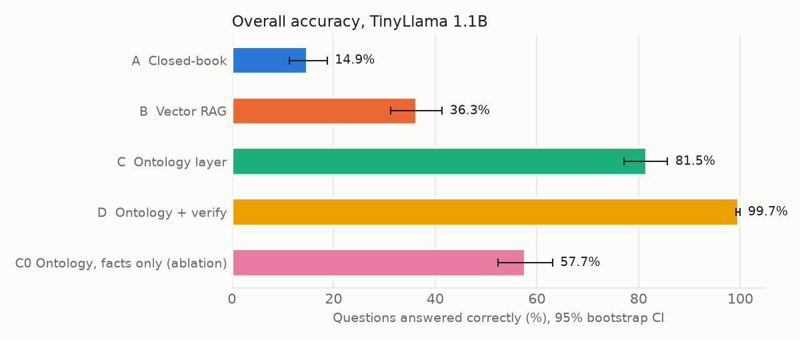
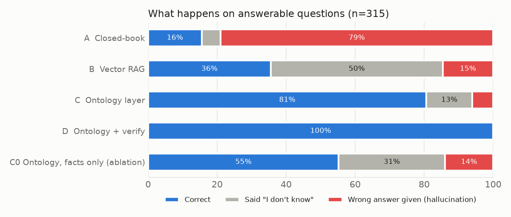
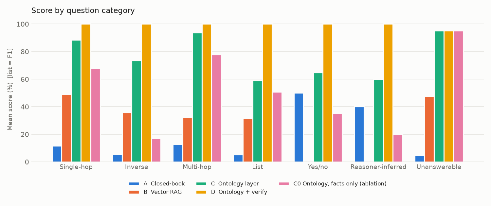

# Ontology layer vs vector RAG vs closed-book: TinyLlama 1.1B on rare genetic diseases

Questions: **336** · Arms: **5** · Model: `tinyllama` (1.1B, Ollama, temperature 0, seed 42, repeat_penalty 1.0) · Knowledge source for every retrieval arm: the same OWL file (50 diseases, 1,632 asserted triples + inverses + HermiT-inferred class membership).

## Headline

| Arm | Accuracy (95% CI) | Strict | Mean score | Hallucination (answerable) | Abstains when answer is unknowable | Paraphrase subset | Avg prompt tokens | Avg LLM latency |
|---|---|---|---|---|---|---|---|---|
| A  Closed-book | 14.9% (11.3%–18.8%) | 11.6% | 14.4% | 79.0% | 4.8% | 6.7% | 83 | 0.53s |
| B  Vector RAG | 36.3% (31.2%–41.4%) | 31.5% | 35.1% | 14.6% | 47.6% | 20.0% | 406 | 0.54s |
| C  Ontology layer | 81.5% (77.1%–85.7%) | 79.5% | 80.8% | 6.0% | 95.2% | 86.7% | 187 | 0.30s |
| D  Ontology + verify | 99.7% (99.1%–100.0%) | 99.7% | 99.7% | 0.0% | 95.2% | 96.7% | 187 | 0.23s |
| C0 Ontology, facts only (ablation) | 57.7% (52.4%–63.1%) | 54.2% | 56.7% | 14.0% | 95.2% | 53.3% | 166 | 0.28s |

## By question category (mean score; list questions use F1)

| Category | n | A | B | C | D | C0 |
|---|---|---|---|---|---|---|
| Single-hop | 112 | 11.6% | 49.1% | 88.4% | 100.0% | 67.9% |
| Inverse | 53 | 5.7% | 35.8% | 73.6% | 100.0% | 17.0% |
| Multi-hop | 66 | 12.8% | 32.4% | 93.7% | 100.0% | 77.8% |
| List | 40 | 5.1% | 31.5% | 59.1% | 100.0% | 50.7% |
| Yes/no | 34 | 50.0% | 0.0% | 64.7% | 100.0% | 35.3% |
| Reasoner-inferred | 10 | 40.0% | 0.0% | 60.0% | 100.0% | 20.0% |
| Unanswerable | 21 | 4.8% | 47.6% | 95.2% | 95.2% | 95.2% |

## Significance (paired, exact McNemar on per-question correctness)

| Comparison | Only first correct | Only second correct | p-value |
|---|---|---|---|
| C vs B | 168 | 16 | 3.8e-33 |
| D vs B | 213 | 0 | 1.5e-64 |
| C0 vs B | 105 | 33 | 6.1e-10 |
| B vs A | 111 | 39 | 3.4e-09 |
| C vs A | 236 | 12 | 4e-55 |
| D vs C | 61 | 0 | 8.7e-19 |

## Retrieval diagnostics (no LLM involved)

- Ontology layer plan returns exactly the gold answer: **335/336** questions.
- Vector RAG top-4 passages contain the gold answer: **236/273** entity-answer questions. By category: Single-hop 111/112, Inverse 51/53, Multi-hop 32/66, List 40/40, Reasoner-inferred 2/2.
- Arm D verifier actions: kept 217, corrected 99, abstained 20 ("corrected" = the LLM's answer disagreed with the graph and was replaced by the graph result).

## How to read this

- **Same knowledge, different representation.** RAG passages are generated from the same triples (including inverses and the reasoner's inferences), in the same sentence style as the ontology facts. The difference between B and C is which facts reach the model and whether the graph has already done the join.
- **C gives the model the query result line** ("Answer from the ontology query: ..."). **C0** removes that line and keeps only the retrieved facts, to separate the value of graph *retrieval* from graph *computation*.
- **D** = C plus a deterministic check: abstain when the question's entity is not in the ontology, and replace answers that contradict the graph. D's accuracy is largely the planner's accuracy; the LLM contributes fluency.
- **Grading is automatic string matching** against KB labels plus aliases and accepted alternatives (`data/aliases.json`, `data/accepted_alternatives.json`). An answer containing an abstention phrase is never counted correct. Names are matched across punctuation boundaries only, and gold names of 6+ characters are also accepted with small misspellings (fuzzy ratio >= 90), after masking exact entity mentions and spans that echo the question, applied identically to every arm.
- **Grader audit.** A 60-answer random sample (`audit_sample.csv`) was checked by reading each answer (by Claude, not a human annotator - redo this with two people before publishing). The exact-match grader agreed on 57/60; all 3 disagreements were TinyLlama misspelling a correct name it copied from the context ("Low-Faat Diet"), which motivated typo tolerance. Every answer whose grade changed because of typo tolerance (67, all in arms B/C/C0) is listed by `src/audit_typos.py` and was read; all were misspellings of the gold answer.

## Threats to validity

- The ontology layer and the question templates were written by the same author. The hand-written paraphrase subset (30 questions) is a partial check, not a blind test; a colleague-written question set would be stronger.
- Gold answers come from the OWL file, so arms using the file are evaluated on their home turf. The closed-book arm can be medically right but disagree with the file; accepted alternatives cover the known cases only.
- 46/50 diseases are autosomal recessive; inheritance questions were stratified so guessing 'recessive' is not enough.
- Some enzyme questions are trivial because the enzyme is in the disease name (e.g. Biotinidase Deficiency).
- One deliberate trap question (a fictional variant of PKU) fools the ontology layer's entity linker.

## Ontology issues found (source file not modified)

- Citrullinemia Type I and Argininosuccinic Aciduria are typed `AminoAcidMetabolismDisorder`; clinically they are urea cycle disorders (excluded from class questions).
- `CofactorResponsiveDisorder` had no equivalentClass axiom; it is added in memory before running HermiT.
- Only Biotin and Vitamin B12 cofactors are modelled; homocystinuria's B6 (PLP) responsiveness is missing.
- `hasCausativeGene` is functional, so multi-gene diseases record one gene (MSUD, propionic acidemia, Zellweger).
- The IRI `GlycogenStorageDiseaseTypeIVonGierke` reads as "Type IV" though the label correctly says Type I.
- Non-enzymes (HFE, LDLR, CFTR, ATM) are under `hasDeficientEnzyme`; placeholder metabolites exist for 6 diseases.
